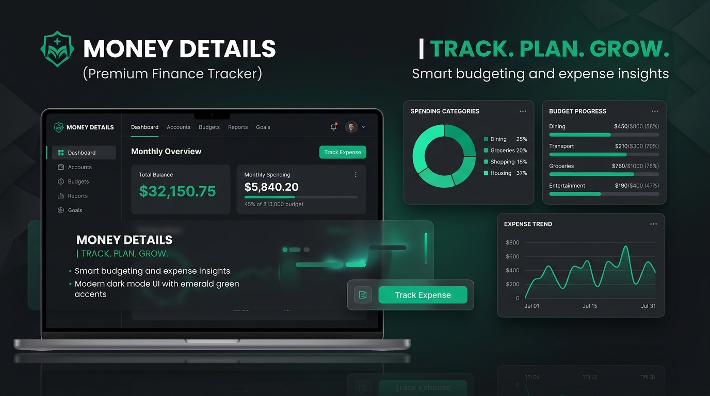
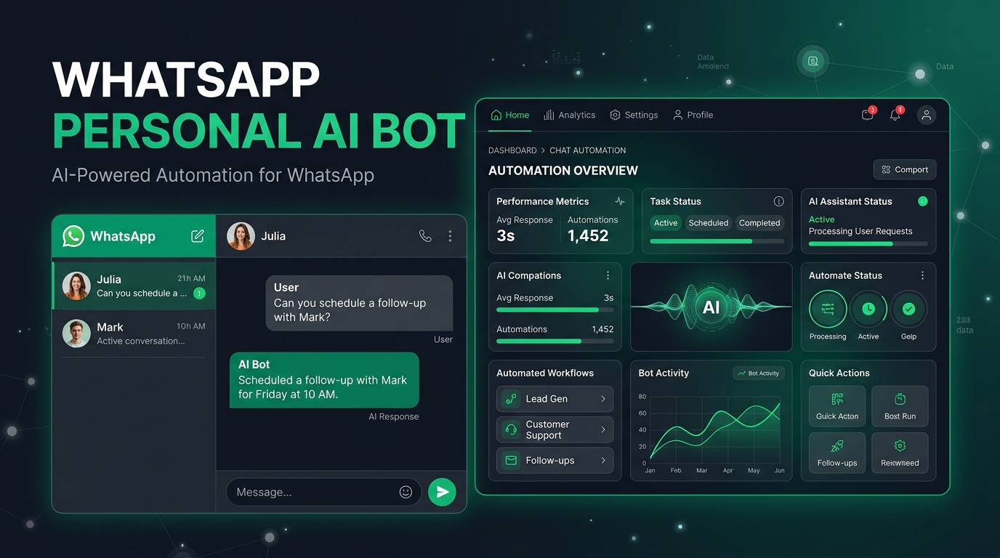
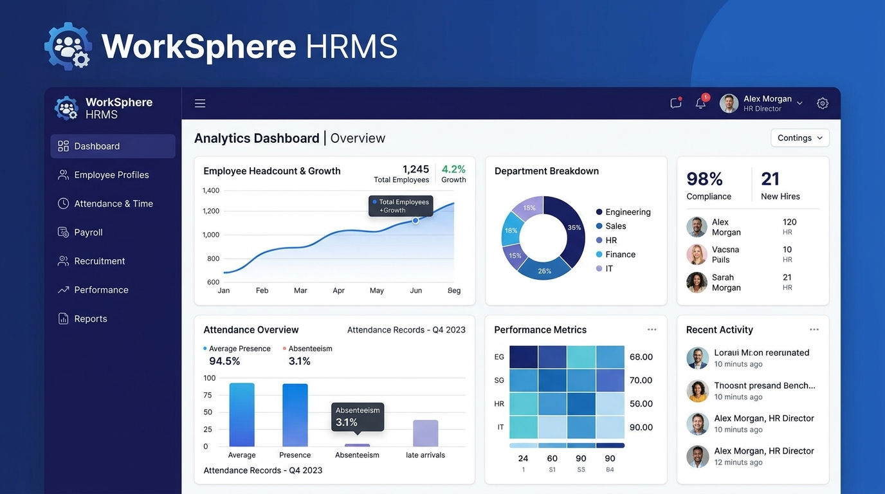
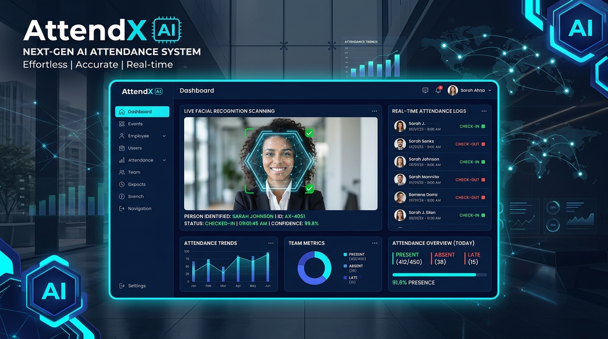
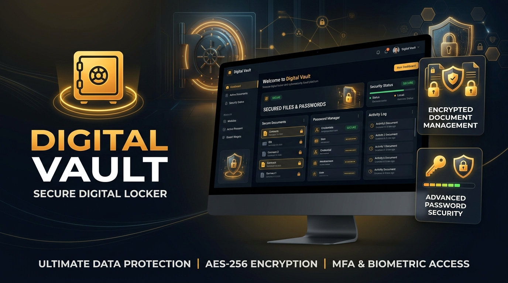
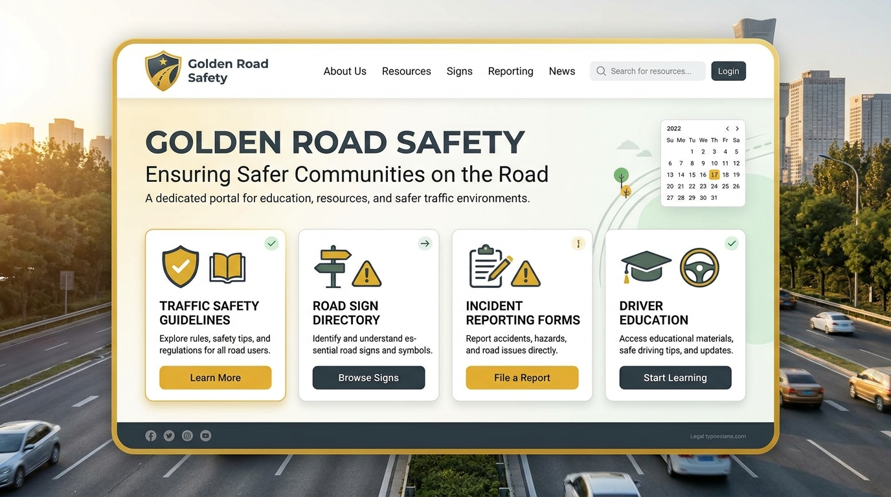

# 🌟 Nitesh Kumar — Developer Portfolio & Admin CMS 2.0

<div align="center">


<br />


<p align="center">
  A production-grade, 60fps Full-Stack Developer Portfolio & Real-Time Admin CMS engineered for <strong>Nitesh Kumar</strong> (B.Tech CSE • Full-Stack MERN & AI Developer).
  <br />
  Featuring <strong>all-device fluid responsiveness (320px–4K)</strong>, <strong>3-mode appearance (Light • Dark • System)</strong>, <strong>43+ verified certifications</strong>, <strong>atomic #01, #02... automatic serial numbering</strong>, <strong>independent split-scroll Admin Console</strong>, and a <strong>405-proof Hybrid Universal AI Scanner</strong>.
</p>

[✨ Live Portfolio](https://ais-pre-oe6qbjz4s6oqsk3b5ppqce-378684240832.asia-southeast1.run.app) • [🔐 Admin Console (`/#/admin`)](https://ais-pre-oe6qbjz4s6oqsk3b5ppqce-378684240832.asia-southeast1.run.app/#/admin) • [📬 Contact Developer](mailto:nitesh933438@gmail.com)

</div>

---

## 📸 Screenshots & Visual Showcase

### 🏆 Featured Full-Stack & AI Projects Gallery
<div align="center">
  <table>
    <tr>
      <td align="center" width="50%">
        
        <br />
        <strong>#01 • Money Details — Smart Finance & Ledger Platform</strong>
      </td>
      <td align="center" width="50%">
        
        <br />
        <strong>#02 • WhatsApp Personal AI Automation Bot</strong>
      </td>
    </tr>
    <tr>
      <td align="center" width="50%">
        
        <br />
        <strong>#03 • WorkSphere HRMS — Enterprise Workforce Suite</strong>
      </td>
      <td align="center" width="50%">
        
        <br />
        <strong>#04 • AttendX AI — Biometric & Smart Attendance</strong>
      </td>
    </tr>
    <tr>
      <td align="center" width="50%">
        
        <br />
        <strong>#05 • Digital Vault — Encrypted Cloud Document Hub</strong>
      </td>
      <td align="center" width="50%">
        
        <br />
        <strong>#06 • Golden Hour Road Safety & Emergency Portal</strong>
      </td>
    </tr>
  </table>
</div>

---

## 📑 Table of Contents

- [Screenshots & Visual Showcase](#-screenshots--visual-showcase)
- [Overview](#-overview)
- [Key Features](#-key-features)
  - [1. All-Device & All-Mode Public Portfolio](#1-all-device--all-mode-public-portfolio)
  - [2. Independent Split-Scroll Admin CMS](#2-independent-split-scroll-admin-cms)
  - [3. 100% Automatic Serial Numbering Engine (`#01, #02...`)](#3-100-automatic-serial-numbering-engine-01-02)
  - [4. 405-Proof Hybrid Universal AI Scanner & Storage](#4-405-proof-hybrid-universal-ai-scanner--storage)
  - [5. Interactive Resume & A4 PDF Print Engine](#5-interactive-resume--a4-pdf-print-engine)
- [Tech Stack & Architecture](#-tech-stack--architecture)
- [Project Directory Structure](#-project-directory-structure)
- [Getting Started](#-getting-started)
- [Security & Authentication](#-security--authentication)
- [Deployment Guide](#-deployment-guide)
- [Keyboard Shortcuts](#-keyboard-shortcuts)
- [Author & Credits](#-author--credits)

---

## 🚀 Overview

**Portfolio & Admin CMS 2.0** is an end-to-end developer showcase and real-time content management system built with **React 19, TypeScript, Tailwind CSS v4, Firebase Firestore, Supabase Storage, and Google Gemini AI**:

1. **Zero-Lag 60fps Experience**: Bundled initial state hydration renders all 9+ projects, 43+ certificates, academic semesters, skills, and experiences in **0ms on frame 1**, while Firestore real-time listeners synchronize live changes in the background.
2. **All System Devices & All Appearance Modes**: Fluid `clamp()` typography and spacing scale seamlessly from `320px` compact mobile screens to `4K` desktop monitors across **Light Mode**, **Dark Mode**, and **System Mode**.
3. **100% Automatic Serial Number System**: Every collection (`Certificates`, `Projects`, `Project Screenshots`, `Experience`, `Skills`) automatically maintains contiguous `#01, #02, #03...` serial numbers whenever items are added, edited, moved (`↑` Up, `↓` Down, `⇈` Top `#01`), or deleted.
4. **Hybrid Server + Client Fallback Engine**: Works identically on full-stack Node/Express deployments and static hosts (GitHub Pages / nginx) with zero `405 Not Allowed` errors.

---

## 💎 Key Features

### 1. All-Device & All-Mode Public Portfolio
- **3-Mode Theme Switcher (`Light` • `Dark` • `System`)**: Direct segmented mode switcher in the Navbar, Admin Header, and Mobile Drawer with native `color-scheme` adaptation for scrollbars and form controls.
- **Academic & University Transcripts**:
  - Live B.Tech CSE semester SGPA trajectory (`Sem 1: 7.91 → Sem 2: 9.23`) at **Arka Jain University** plus Class XII & Class X board records.
- **Featured Projects & Row-Wise Screenshot Walkthrough**:
  - Category filters, instant search, and detailed project modals with multi-category screenshot galleries (`Poster Cover #01`, `Desktop Web`, `Mobile App`, `Admin Console`) and full-screen zoom viewer.
- **43+ Verified Certifications Hub**:
  - Ranked in curated merit order starting with **`#01` NPTEL Programming in Java (Elite)**, **Infosys Springboard**, **Oracle**, **AWS**, **Cisco**, and **HackerRank**.
  - Dedicated verification route (`/#/verify/:certId`) and live issuer verification URL detection.

### 2. Independent Split-Scroll Admin CMS
- **Isolated Scroll Containers (`h-dvh overflow-hidden`)**:
  - **Left Sidebar** and **Right Main Viewport** have completely independent scrollbars (`overscroll-contain`). Scrolling the right content never moves the sidebar.
- **Adaptive Responsive Shell**:
  - **Desktop (`1280px+`)**: Expanded full sidebar (`w-64`).
  - **Compact Laptops (`1024px–1279px`)**: Auto-collapsed icon rail (`w-20`) with 1-click expand toggle.
  - **Mobile & Tablet (`< 1024px`)**: Auto-centering horizontal quick-navigation tab bar + slide-out mobile drawer.
- **0ms Instant Tab Switching**: All Admin modules (`Overview`, `Projects`, `Certificates`, `Education`, `Skills`, `Experience`, `Messages`, `Settings`, `AI Assistant`) are eagerly loaded for instantaneous switching.

### 3. 100% Automatic Serial Numbering Engine (`#01, #02...`)
- **Atomic Firestore Batch Re-Indexing (`writeBatch`)**:
  - Adding a new item, deleting an item, editing the `Serial # (Position)` field, or clicking **Move to `#01` Start (`⇈`)**, **Move Up (`↑`)**, or **Move Down (`↓`)** immediately recalculates all serial numbers (`#01, #02, #03...`) and commits them in a single atomic batch.
- **Automatic Screenshot Title Prefix Sync**:
  - Reordering or deleting project screenshots automatically updates their title prefixes (`01 – ...`, `02 – ...`, `03 – ...`) and cover status (`#01` = Poster Cover).

### 4. 405-Proof Hybrid Universal AI Scanner & Storage
- **Universal AI Auto-Fill (`AIScanner.tsx` + `src/services/api.ts`)**:
  - Accepts **PDF / JPG / PNG / WEBP documents**, **pasted text**, or **GitHub repository URLs**.
  - Automatically calls the Express + Gemini AI endpoint when available, and seamlessly falls back to the built-in **Client-Side Smart Extractor** + **GitHub REST API** when hosted on static servers (preventing `405 Not Allowed` errors).
- **Resilient File Uploads (`src/services/supabaseStorage.ts`)**:
  - Supports Express proxy upload (Supabase Storage + local `/public/uploads/` disk storage) and automatic client-side canvas image compression / Data URL persistence on static hosts.

### 5. Interactive Resume & A4 PDF Print Engine
- **Dual-Tab Resume Modal**:
  - **Document View**: High-resolution preview of the official signed CV with zoom controls (`60%–220%`).
  - **Interactive ATS View**: Live structured resume dynamically synced with portfolio projects, skills, and academic records.
  - **One-Click Print & Download**: Dedicated A4 portrait print stylesheet and direct PDF download.

---

## 🛠 Tech Stack & Architecture

```text
┌─────────────────────────────────────────────────────────────────────────┐
│                            Client (Browser)                             │
│   React 19 + TypeScript • Tailwind CSS v4 • Motion • Lucide Icons       │
│   Instant Bundled State Hydration + Client-Side Smart AI/Upload Engine  │
└───────────────────┬─────────────────────────────────┬───────────────────┘
                    │                                 │
        (Real-Time Sync & Batch Writes)     (API Proxy / Hybrid Fallback)
                    │                                 │
                    ▼                                 ▼
┌───────────────────────────────────┐ ┌───────────────────────────────────┐
│        Firebase Firestore         │ │       Express Backend Server      │
│  Auth • Atomic writeBatch • RBAC  │ │   Gemini AI SDK • Multer • CORS   │
└───────────────────────────────────┘ └───────────┬───────────────┬───────┘
                                                  │               │
                                                  ▼               ▼
                                      ┌───────────────┐ ┌─────────────────┐
                                      │ Supabase Cloud│ │ /public/uploads │
                                      │    Storage    │ │  Local Storage  │
                                      └───────────────┘ └─────────────────┘
```

| Layer | Technologies |
| :--- | :--- |
| **Frontend** | React 19, TypeScript, React Router DOM v7 (`HashRouter`), Vite 8 |
| **Styling & UI** | Tailwind CSS v4 (`@import "tailwindcss";`), Fluid CSS Clamp Variables, Motion (`motion/react`), Lucide Icons |
| **Backend Server** | Node.js (`>=24.12.0`), Express 4, Multer, Sharp, CORS |
| **Database & Auth** | Firebase Firestore (`writeBatch`, real-time `onSnapshot`), Firebase Google Auth |
| **Storage Engine** | Supabase Storage + Local `/public/uploads/` fallback + Client Canvas DataURL fallback |
| **AI Capabilities** | Google Gemini (`@google/genai`) + Client-Side Heuristic & GitHub API Extractor |

---

## 📂 Project Directory Structure

```text
my-portfolio-2.0/
├── public/
│   ├── assets/                   # Official resume PDF & high-res resume page image
│   ├── certificates/             # 43+ bundled high-res certificate images & PDFs
│   ├── images/
│   │   ├── banners/              # Project showcase cover banners
│   │   └── projects/             # Ordered row-wise project screenshot galleries
│   ├── favicon.svg               # Precision vector NK monogram icon
│   └── manifest.json             # PWA Web App Manifest
├── src/
│   ├── components/
│   │   ├── admin/                # Modular Admin CMS Managers
│   │   │   ├── AdminOverview.tsx           # Real-time KPI metrics & audit logs
│   │   │   ├── AIAssistantPage.tsx         # Gemini Portfolio Assistant & Scanner launcher
│   │   │   ├── AIScanner.tsx               # Universal AI Auto-Fill Modal (File/Text/URL)
│   │   │   ├── EducationManager.tsx        # B.Tech Semesters & Schooling CMS
│   │   │   ├── ExperienceManager.tsx       # Experience CMS with #01, #02 auto-serials
│   │   │   ├── MessagesManager.tsx         # Contact inquiries inbox
│   │   │   ├── ProjectsManager.tsx         # Projects CMS with #01, #02 auto-serials
│   │   │   ├── ProjectScreenshotManager.tsx# Drag-and-drop screenshot ordering & cover sync
│   │   │   ├── SettingsManager.tsx         # Profile, bio, resume & social links CMS
│   │   │   └── SkillsManager.tsx           # Skill categories & proficiency CMS
│   │   ├── AdminLayout.tsx                 # Independent split-scroll Admin shell
│   │   ├── CertificateAdminPage.tsx        # Certificates CMS with sticky form & #01..#43+ serials
│   │   ├── CertificateVerifyPage.tsx       # Official credential verification page
│   │   ├── Certifications.tsx              # Public 43+ certifications catalog & viewer
│   │   ├── Education.tsx                   # Public university & school records showcase
│   │   ├── FeaturedProjects.tsx            # Elite projects showcase
│   │   ├── Hero.tsx                        # Responsive hero section with KPI strip
│   │   ├── Navbar.tsx                      # All-device header with 3-mode theme switcher
│   │   ├── ProjectModal.tsx                # Row-wise screenshot walkthrough modal
│   │   ├── ProjectsCatalogue.tsx           # Searchable & filterable project catalog
│   │   └── ResumeModal.tsx                 # Document & Interactive ATS resume modal
│   ├── data/                     # Bundled initial data & screenshot metadata catalog
│   ├── services/                 # Firebase, Supabase, and 405-proof Smart API services
│   ├── App.tsx                   # Root router & theme controller
│   └── index.css                 # Tailwind v4 & fluid responsive design tokens
├── firestore.rules               # Production Firestore security rules
├── server.ts                     # Full-stack Express API & static server
└── package.json                  # Project scripts & dependencies
```

---

## ⚡ Getting Started

### 1. Clone & Install
```bash
git clone https://github.com/nitesh933438/my-portfolio-2.0.git
cd my-portfolio-2.0
npm install
```

### 2. Environment Variables (`.env`)
Copy `.env.example` to `.env`. All AI and upload features include automatic fallbacks even if optional keys are omitted:
```env
PORT=3000
GEMINI_API_KEY=your_gemini_api_key
VITE_SUPABASE_URL=https://your-project.supabase.co
VITE_SUPABASE_ANON_KEY=your_supabase_anon_key
SUPABASE_SERVICE_ROLE_KEY=your_supabase_service_role_key
```

### 3. Run Development Server
```bash
npm run dev
```
Open `http://localhost:3000` in your browser.

### 4. Production Build
```bash
npm run build
npm start
```

---

## 🔒 Security & Authentication

- **Hidden Admin Entry**:
  1. Navigate to `/#/admin`
  2. Press `Ctrl + Shift + Z` (or `Cmd + Shift + Z` / `Ctrl + Shift + A`) from anywhere on the portfolio
  3. Click the discreet separator dot (`•`) in the footer copyright line
- **Authorized Google Sign-In**: Protected by Firebase Authentication and `firestore.rules` so only authorized administrator accounts can modify portfolio records.

---

## ⌨ Keyboard Shortcuts

| Shortcut | Action |
| :--- | :--- |
| `Ctrl + Shift + Z` / `Cmd + Shift + Z` | Toggle Admin CMS Console (`/#/admin`) |
| `Ctrl + Shift + A` | Alternate shortcut to open Admin CMS |
| `Esc` | Close active modal, drawer, or full-screen image viewer |

---

## 👨‍💻 Author

**Nitesh Kumar**  
*B.Tech Computer Science & Engineering • Full-Stack MERN & AI Developer*  
📍 Rohtas, Bihar, India  
- **Email**: [nitesh933438@gmail.com](mailto:nitesh933438@gmail.com)
- **GitHub**: [github.com/nitesh933438](https://github.com/nitesh933438)

---

<div align="center">
  <sub>Crafted with precision by Nitesh Kumar • All-Device & All-Mode Production Ready</sub>
</div>
